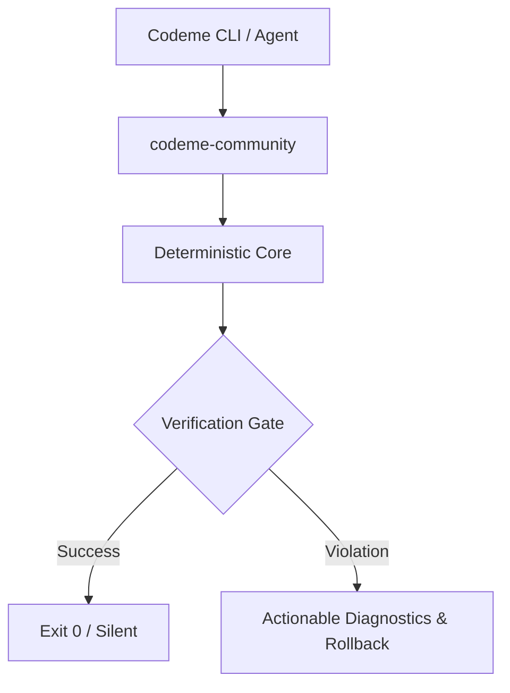

# codeme-community

> **Deterministic open-source verification, linting, syntax repair, and build verification core**

  <a href="https://github.com/CodeMe-Tools"><b>CodeMe Ecosystem</b></a> &bull;
  <a href="https://github.com/CodeMe-Tools/codeme-docs"><b>Documentation</b></a> &bull;
  <a href="https://codeme.tools"><b>Official Website</b></a>

---

## Overview

`codeme-community` is a core component of **Codeme** — the autonomous code quality, verification, and invariant platform.

### Key Capabilities
- **Deterministic Local Execution:** Zero-byte stdout/stderr on success (`exit 0`), actionable diagnostics on failure.
- **Cross-Platform:** Native support across macOS, Linux (Ubuntu priority), and Windows.
- **Offline-First:** Runs without cloud dependencies or paid per-call inference.
- **Agent-Ready:** Tailored for seamless integration with autonomous AI coding agents.

## Governance & Boundaries
- **Ownership:** `codeme-tools/codeme-community`
- **Visibility:** `PUBLIC`
- **License:** `Apache-2.0`
- **Allowed Component Namespaces:** `codeme-syntax`, `codeme-quality`, `codeme-verify`, `codeme-toolchain-base`

## Security Policy
Please review [SECURITY.md](SECURITY.md) for vulnerability reporting guidelines. Under no circumstances may proprietary code or customer tokens be committed to public repositories.

## Contributing
See [CONTRIBUTING.md](CONTRIBUTING.md) for branch management, conventional commit guidelines, and verification rules.
